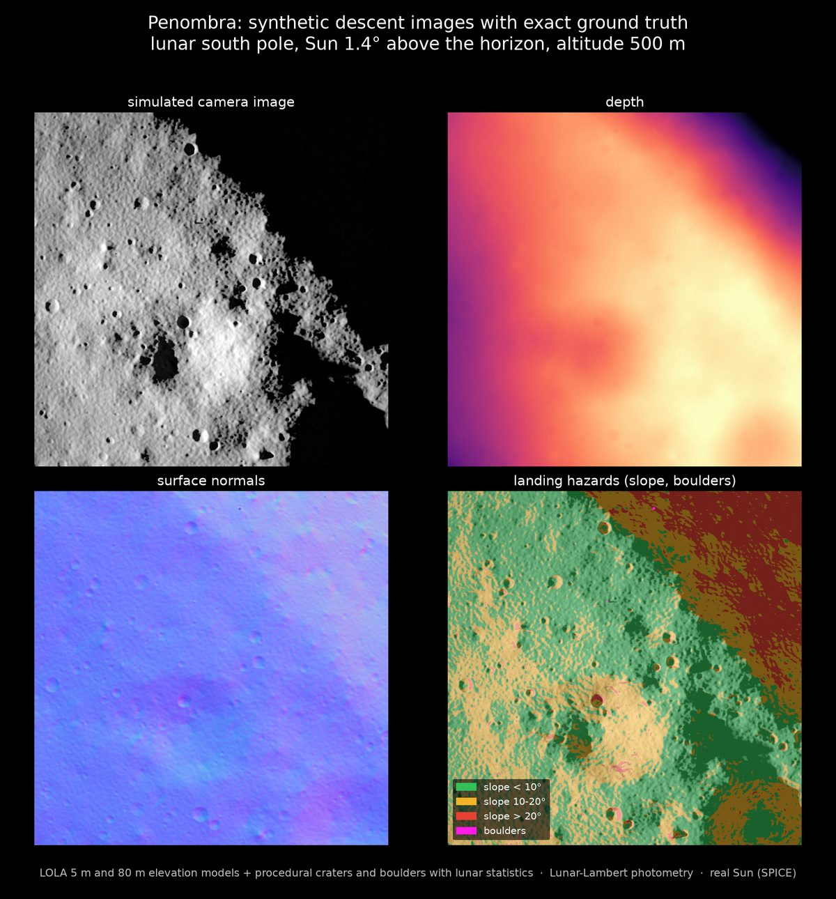

# Penombra

**Synthetic descent images of the lunar south pole, with exact ground truth for every pixel.**

Website: **https://roccocherubini.github.io/penombra/**
Interactive demo: **https://roccocherubini.github.io/penombra/demo.html**

Near the lunar south pole the Sun stays within a few degrees of the horizon. Long shadows
hide much of the ground, and a lander that navigates by its camera has to work in exactly
that light. Penombra renders what the navigation camera sees during a powered descent,
from NASA LOLA elevation data and the real position of the Sun, and delivers the exact
answer for every pixel: depth, 3D position, surface normal, optical flow, landing hazards
and camera pose.

## What is here

- `index.html` and `assets/`: the project page, published with GitHub Pages.
- `demo.html` and `assets/demo/`: Demo v0, map-based navigation when the Sun moves (interactive).
- Comparison with real photos: four images from the Narrow Angle Camera of NASA's Lunar
  Reconnaissance Orbiter, Sun 1.2–1.4° above the horizon, against Penombra renders of the
  same ground at the same instant (86–99% of pixels in the same light or shadow).
- Sample dataset v0 (24 frames, descent to the rim of Shackleton, 734 MB): coming soon on
  Zenodo, with a short program to load it.

Custom sequences (your landing site, trajectory, date and camera) are available on request.

## Contact

Rocco Cherubini, Turin, Italy
roccocherubini5@gmail.com
https://www.linkedin.com/in/rocco-maria-cherubini-a941bb3a0

## Licence

Page, images and videos: CC BY 4.0 (see `LICENSE`). Elevation data: NASA LOLA; Sun and
Moon positions: NASA NAIF SPICE; orbital photos: NASA/GSFC/Arizona State University (LROC).
